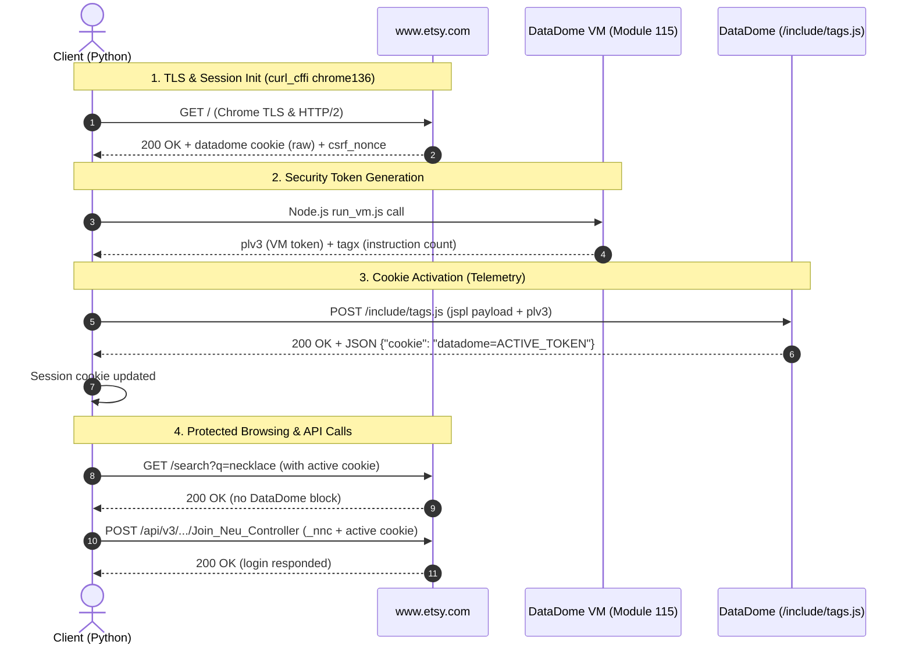

# Etsy DataDome Bypass & Session Client

A Python and Node.js based client for bypassing DataDome bot protection on Etsy — handles session management, Chrome TLS impersonation, telemetry generation, and login/search requests.

---

## Project Structure

```text
etsy reverse/
│
├── main.py                     # CLI entry point (test, search, login)
├── README.md                   # Project documentation
│
├── core/                       # Core Etsy & DataDome Client
│   ├── __init__.py             # Module exports (EtsyClient, get_vm_token)
│   ├── etsy_client.py          # Chrome TLS session, tags.js telemetry, API requests
│   └── vm_bridge.py            # Bridge between Python and DataDome Module 115 VM (run_vm.js)
│
└── challenge/                  # DataDome Interstitial Challenge Solver
    ├── __init__.py             # Module exports
    ├── interstitial_solver.py  # Solves 'rt: i' device verification challenges automatically
    ├── run_interstitial.js     # Node.js virtual browser that generates telemetry payload
    └── _interstitial_cache.js  # Local cache for the interstitial JS bundle
```

---

## How Each File Works

### `core/`
- **`etsy_client.py` (`EtsyClient`)**:
  - Impersonates `chrome136` TLS (JA3/JA4) and HTTP/2 handshake using `curl_cffi`.
  - Fetches the homepage to extract `uaid`, the initial `datadome` cookie, and `<meta name="csrf_nonce">`.
  - Builds a realistic browser hardware profile (WebGL, Canvas, screen resolution, mouse/keyboard events) via `build_jspl_body()`.
  - Sends telemetry to `/include/tags.js` to **activate** the DataDome cookie.
  - Fetches protected Etsy pages and handles login requests via `Join_Neu_Controller`.
- **`vm_bridge.py` (`get_vm_token`)**:
  - Runs DataDome's Module 115 virtual machine in Node.js (`../datadome-vm-main/run_vm.js`).
  - Returns the `plv3` (r) and `tagx` (i — instruction count) values expected by DataDome.

### `challenge/`
- **`interstitial_solver.py`**: Automatically handles DataDome `rt: 'i'` device check challenges triggered during Etsy browsing.
- **`run_interstitial.js`**: Runs the DataDome interstitial script in a mock DOM/BOM environment (window, document, canvas, webgl) and captures the POST payload.
- **`_interstitial_cache.js`**: Local cache of the challenge JS bundle to avoid re-downloading on each run.

### `main.py`
CLI entry point. Run searches, full flow validation, or login tests with a single command.

---

## How the DataDome 403 Bypass Works



**Three root causes of 403s and how they are fixed:**

1. **TLS / JA3 & HTTP/2 fingerprint**: Standard Python `requests` uses an OpenSSL fingerprint that DataDome detects at the TLS handshake level. `curl_cffi` provides a real `chrome136` TLS fingerprint, ciphersuite ordering, and HTTP/2 SETTINGS frames.

2. **Raw DataDome cookie activation**: Etsy issues a temporary cookie on first visit. Without sending telemetry to `/include/tags.js` (as a real browser would), all subsequent requests are flagged. The Node.js VM generates `plv3` and the cookie is validated via `tags.js`.

3. **Dynamic CSRF nonce**: The login endpoint (`Join_Neu_Controller`) requires the `<meta name="csrf_nonce">` value from the homepage. It is extracted with regex and injected into every login request.

---

## Requirements

1. **Python 3.10+**
2. **Node.js v18+**
3. **`datadome-vm-main`** folder present at `../datadome-vm-main` relative to this project.

```bash
pip install curl_cffi
```

---

## Usage

**Full flow validation (default):**
```bash
python main.py
```

**Search:**
```bash
python main.py --search "leather wallet"
```

**Login test:**
```bash
python main.py --login user@gmail.com Password123!
```

**Use as a library:**
```python
from core.etsy_client import EtsyClient

client = EtsyClient()
client.init_session()
client.activate_datadome()

response = client.get("https://www.etsy.com/search?q=silver+ring")
print(response.status_code)

login_result = client.login("user@gmail.com", "Password123!")
print(login_result["status"])
```
